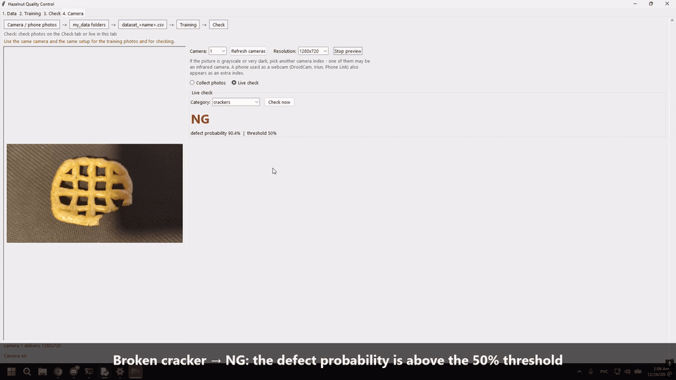
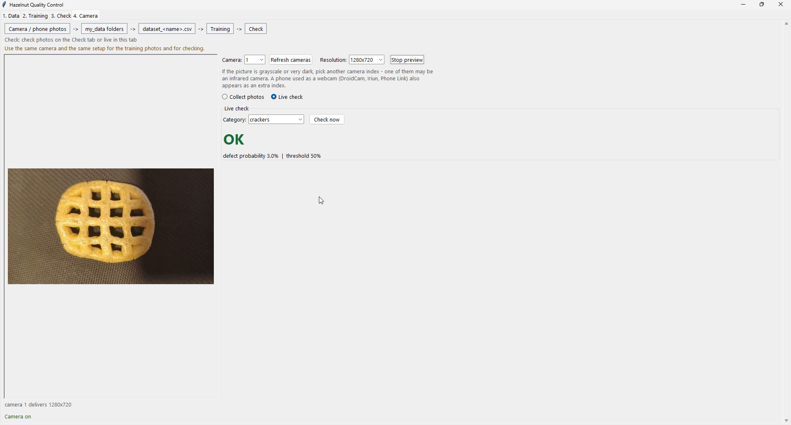
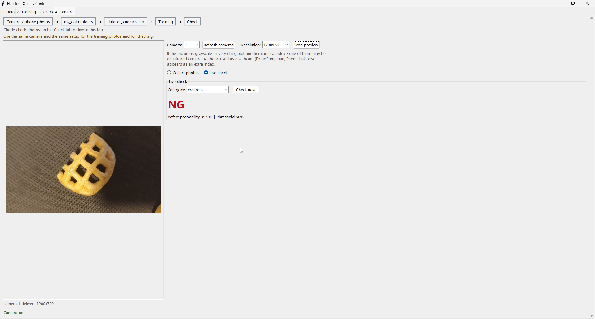
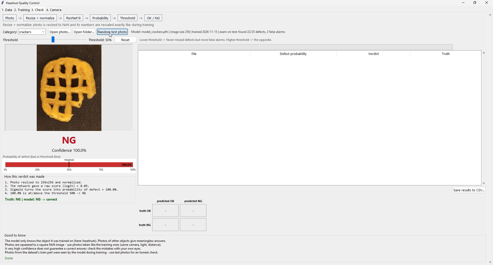

# Cracker Quality Control

A neural network that checks real crackers for defects, live through a phone camera. It looks at each frame and says **OK** (intact) or **NG** (defective), together with the probability of a defect.

The model is a **ResNet18** pretrained on ImageNet and fine-tuned with PyTorch on an RTX 4060 (CUDA), using **206 photos I took of real crackers with my phone**. A Windows desktop app (tkinter) covers the whole workflow: collecting photos, building the dataset, training on the GPU and checking photos or a live camera stream.

This project continues [Hazelnut Quality Control](https://github.com/Perhovin/hazelnut-quality-control), which used the lab-quality MVTec AD photos. Here the data comes from my own camera and lighting, and the camera feed is checked in real time.



Full demo video (66 s, English subtitles): [docs/demo.mp4](docs/demo.mp4)

## Results

Test set: 49 photos (24 OK, 25 NG). None of them were used for training or for choosing the best epoch. They were taken in a separate session under warmer light than the training photos.

| | Result |
|---|---|
| Correct verdicts | **44 / 49 (90%)** |
| Defects found | 22 / 25 (3 missed) |
| Intact crackers flagged as defective | 2 / 24 |

What changed along the way:

| Model | Accuracy on the test set | Comment |
|---|---|---|
| Hazelnut model from the previous project, no retraining | 51% | Calls almost every cracker defective |
| Trained on crackers, basic augmentation (3 runs) | 55-61% | 100% on validation, but most intact crackers under the warmer light were flagged as NG |
| Trained on crackers, strong colour augmentation (3 runs) | 71-90% | Final model: the run with the best **validation** score, which scored 90% on the test set |

Honest notes:

- The test set is small: one photo is 2%.
- I looked at the test results when I decided to switch to strong augmentation, so the 90% is somewhat optimistic. Expect roughly 70-90% on new photos taken under new conditions.
- The final run was picked by validation, not by test score, so that the test set did not decide which model to keep.

## Main lesson: validation is not the real world

The first model reached 100% on validation but only about 60% on the test set. Validation photos were taken in the same session and light as the training photos, so they were too easy. Under warmer light the intact crackers looked orange, and the model called them defective. It had most likely learned "orange = defect", because many defective crackers in the training set were burnt or had ketchup on them.

**Strong augmentation** fixed most of this. During training every photo is randomly changed in brightness, contrast, saturation and colour balance (each RGB channel is scaled separately), and sometimes turned grayscale. Colour stops being a reliable clue, so the model has to look at the shape: broken edges and missing pieces. Only the training photos are changed; validation, test and the photos you check are left untouched.

## Features

- **Camera tab**
  - *Collect photos*: live preview, **Save as OK** / **Save as NG**, **Next item**, **Undo last photo**, counters.
  - *Import photos from a folder*: for phone photos. Orientation is fixed from EXIF, images are converted to JPEG and resized to at most 1600 px, and the originals are not changed.
  - *Final exam set*: items marked this way always go to the test split and are never trained on.
  - *Build table*: splits by physical item (several shots of one cracker always stay in the same split), fixed seed 42, checks for duplicates, unreadable files and missing classes, and warns about class imbalance, mixed aspect ratios or very small images.
  - *Live check*: about 2 verdicts per second on the live stream, without saving frames to disk.
- **Training tab**: trains on the GPU, shows loss and accuracy per epoch, and saves the epoch with the best validation balanced accuracy. Augmentation can be set to `basic` or `strong`.
- **Check tab**: one photo, a whole folder, or a random test photo. Shows the probability bar, the threshold (adjustable without retraining), the step-by-step calculation and the true label.
- **Data tab**: the MVTec AD categories from the previous project still work.

## How it works

1. **Data** (`custom_data.py`): photos live in `my_data/<name>/{ok,ng,holdout_ok,holdout_ng}` and are named `<item>_<shot>.jpg`. **Build table** creates `dataset_<name>.csv` with the columns `path, label, defect, split, group`. Final-exam items become the test split; the rest is split into train and validation by item.
2. **Training** (`train.py`): ResNet18 with the last layer replaced by a single output. Photos are resized to 256x256. Training runs for 25 epochs with AdamW (lr 1e-4) and batch size 32. The loss is binary cross-entropy with `pos_weight = OK / NG` in the training set (1.52 here). One epoch on 126 photos takes about a second on an RTX 4060 Laptop GPU.
3. **Check** (`check.py`, Check tab, live check): the network outputs a raw score (logit), a sigmoid turns it into a probability of defect, and the photo is NG if the probability is at least the threshold (50% by default).

Dataset used for the final model:

| Split | OK | NG | Total |
|---|---|---|---|
| train | 76 | 50 | 126 |
| validation | 19 | 12 | 31 |
| test (final exam) | 24 | 25 | 49 |

## Quick start (Windows)

1. Create a virtual environment and activate it:
   ```
   python -m venv venv
   venv\Scripts\activate
   ```
2. Install PyTorch with CUDA (tested: Python 3.14, torch 2.11.0, torchvision 0.26.0, CUDA 12.8). Use only the PyTorch index; adding PyPI as an extra index can install a CPU-only build on Windows:
   ```
   pip install torch==2.11.0 torchvision==0.26.0 --index-url https://download.pytorch.org/whl/cu128
   ```
   Without an NVIDIA GPU, `pip install torch torchvision` also works, but training is slower.
3. Install the rest:
   ```
   pip install -r requirements.txt
   ```
4. Start the app from the activated terminal with `app.bat` (or `python app.py`).

### Try the trained model

Download `model_crackers.pth` and `model_crackers.json` from [Releases](../../releases) and put them next to `app.py`. Open the **Check** tab, choose `crackers` and open a photo, or use **Camera → Live check**.

The model only knows these crackers, photographed from above on a dark mat. Other objects, backgrounds or lighting give unreliable answers.

### Retrain on my photos

1. Download `crackers_photos.zip` from [Releases](../../releases) and unpack it so that you get `my_data/crackers/ok`, `ng`, `holdout_ok` and `holdout_ng` next to `app.py`.
2. **Camera** tab → dataset name `crackers` → **Build table**.
3. **Training** tab → `crackers`, augmentation `strong` → **Start training**.

From the command line (after step 2):

```
python train.py crackers --aug strong --seed 43
python check.py --category crackers --photo path\to\photo.jpg
```

GPU training is not fully deterministic, so your numbers can differ a little from the table above.

### Use a phone as the camera

On Windows 11, link an Android phone with **Phone Link** and turn on **Settings → Bluetooth & devices → Mobile devices → Use as a connected camera**. The phone then appears as an extra camera index in the Camera tab (in my setup: camera 1, 1280x720). DroidCam or Iriun Webcam work the same way.

### Train on your own objects

1. **Camera** tab → type a new dataset name (lowercase, for example `cookies`).
2. Photograph each item with **Save as OK** / **Save as NG** and press **Next item** between different physical objects, or import a folder of phone photos.
3. Shoot a separate **Final exam set** with other items, ideally on another day.
4. **Build table**, then train on the **Training** tab.

Tips: use one fixed camera and the same setup for training and checking, a plain matte background and diffuse light. Shoot OK and NG items mixed in the same session, and aim for roughly balanced classes (at least 40 + 40 items). On a phone, set the photo format to JPEG (Most Compatible), not HEIC. Your photos stay in `my_data/`, which is git-ignored.

## Files

| File | Purpose |
|---|---|
| `app.py` | Desktop application (tkinter): Data, Training, Check and Camera tabs |
| `custom_data.py` | Storage, import, validation and item-level split for your own photos |
| `train.py` | Fine-tunes ResNet18 on the GPU (`--aug basic/strong`, `--seed`) |
| `check.py` | Classifies one photo from the command line |
| `step2_pandas.py` | Builds the dataset table for an MVTec AD category |
| `paths.py` | Project folder and MVTec folder settings |
| `app.bat`, `check.bat` | Shortcuts for Windows |
| `docs/` | Demo video, GIF and screenshots |

## Screenshots

| Live check: intact cracker | Live check: broken cracker |
|---|---|
|  |  |

| Check tab: test photo with the step-by-step verdict |
|---|
|  |

## Limitations

- One kind of cracker, one background, one camera position. A new setup needs new photos and retraining.
- 206 photos is a small dataset, and 3 of the 25 defective test crackers were still missed.
- The verdict on the live stream updates about twice per second, so it lags briefly while crackers are swapped.
- This is a learning project, not a production inspection system.

## License and credits

- Code: [MIT](LICENSE). Photos and the trained model in Releases: free to use for learning and research.
- ResNet: K. He, X. Zhang, S. Ren, J. Sun, *Deep Residual Learning for Image Recognition*, CVPR 2016.
- The MVTec AD support comes from the previous project. That dataset is licensed under CC BY-NC-SA 4.0 and is not included here.

Author: Mykhailo Shelestiuk. Built with help from an AI coding assistant (Devin).
